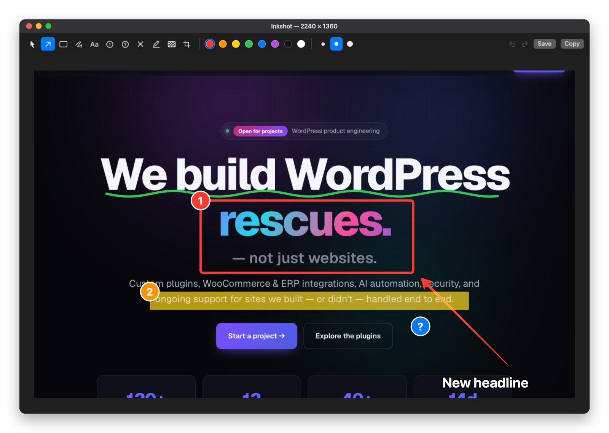
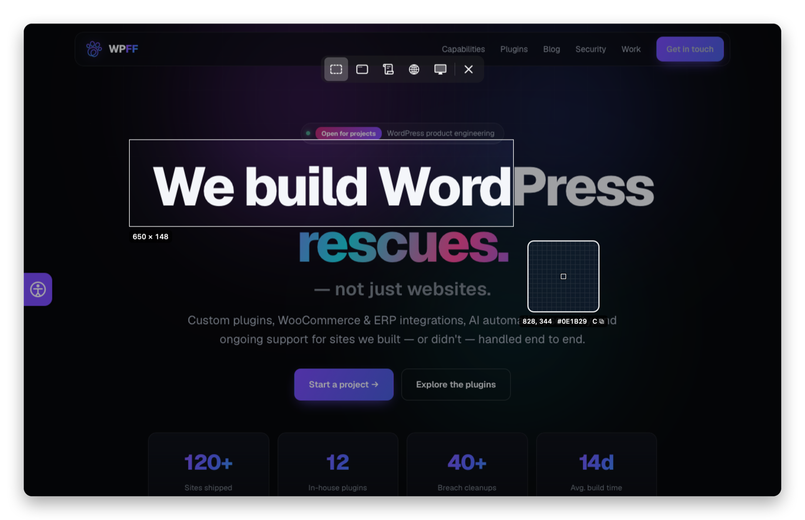
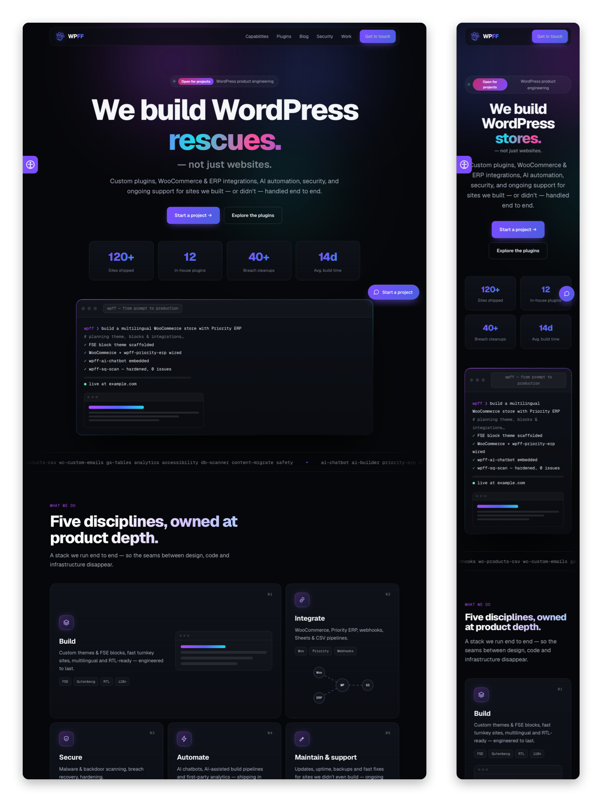
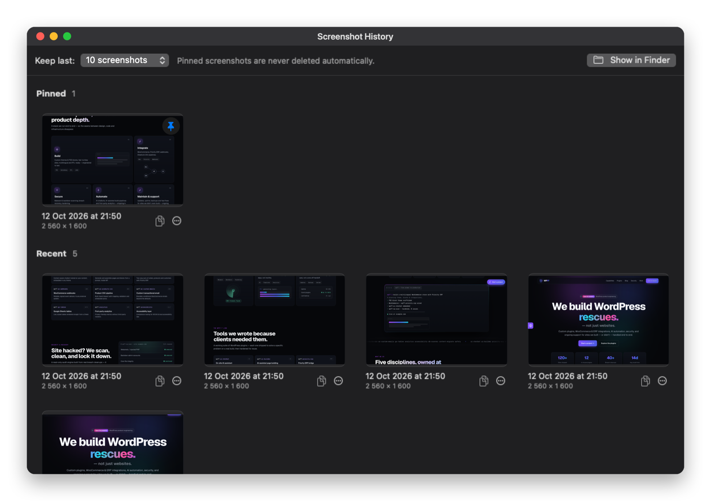

<p align="center">
  
</p>

<h1 align="center">Inkshot</h1>

<p align="center">
  A macOS menu-bar screenshot tool: capture, mark up, copy.<br>
  Scrolling and full web page capture · history · English, Russian, Hebrew
</p>

<p align="center">
  
</p>

## Capture

**Right ⌘ ⇧ P** freezes the screen and shows an icon bar: area · window · scrolling capture ·
full web page · full screen. A pixel loupe shows the position and colour under the pointer;
**C** copies that colour as `#RRGGBB`.

<p align="center">
  
</p>

## Mark up

The capture is on the clipboard right away and opens in the editor: arrow, rectangle, text, step
numbers, highlighter (adapts to light and dark content), blur, crop, undo. Every change updates the
clipboard; ↩ copies and closes, ⌘S saves a PNG. Tool shortcuts use key positions, so they work in any
keyboard layout.

## Whole pages

- **Scrolling capture** — click a window or drag an area, then scroll it at your own pace: Inkshot
  records and stitches the frames (▶ on the panel scrolls for you if you want); side bars that don't
  scroll are cropped away.
- **Full web page** — click a browser window: Inkshot renders the tab's address in a hidden WebKit view at
  window, desktop (1440) or mobile (390) width and captures it in one piece — fixed headers once,
  cookie banners hidden.

<p align="center">
  
</p>

## History

The last captures are kept (10 by default, 5–100); pinned ones are never removed. Reopen one and keep
editing, copy it, or drag it straight into a chat.

<p align="center">
  
</p>

## Build

```bash
./build.sh install     # builds, signs, installs to ~/Applications and launches
```

macOS 14+. Permissions on first use: Accessibility (the hotkey), Screen Recording, Automation (reading
the browser tab's address).

## Tests

```bash
.build/release/Inkshot --self-test                 # stitching, history, pasteboard, highlighter brightness
.build/release/Inkshot --render-test out.png       # editor rendering; also --loupe-test, --highlight-test
.build/release/Inkshot --web-test <url> out.png [width] [mobile]
.build/release/Inkshot --readme-shots <desktop.png> <mobile.png> docs/images   # regenerates these screenshots
```

Debug: `defaults write com.viafirst.inkshot debugScrollFrames -bool YES` saves scrolling-capture frames to
`~/Library/Application Support/Inkshot/Debug/`; replay them with `--replay <dir>`.

License: MIT.
